# PRAKTIKUM PERMROGRAMAN WEB 6
JavaScript DOM dan Event Handling

**Nama:** Aidi Syahdan Firdaus  
**NIM:** 312510089  
**Kelas:** 1251A  

---

### Pertama siapkan dulu bahan-bahan praktikum
1. Buat folder bernama `lab6_dom_event`
2. Buat 3 file di dalam folder tadi `index.html`, `style.css`, dan `script.js`
3. Hubungkan file CSS dan Javascript di html dengan code di bawah ini

**index.html**

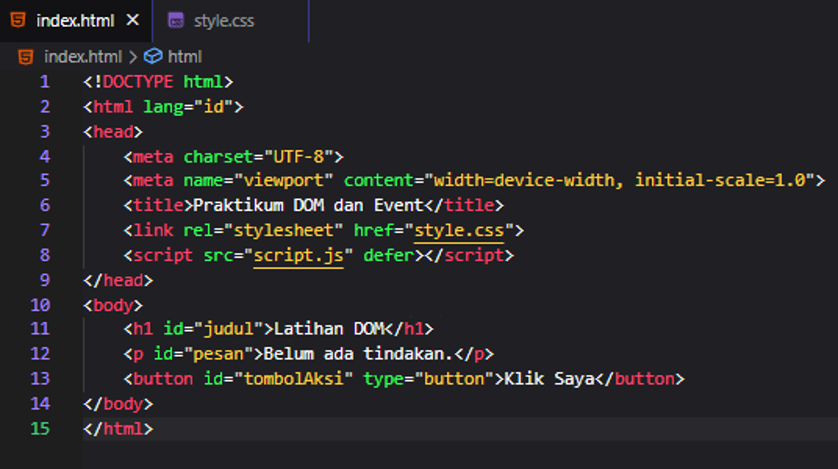

4. Terakhir buka halaman browser dan buka developer tools/console

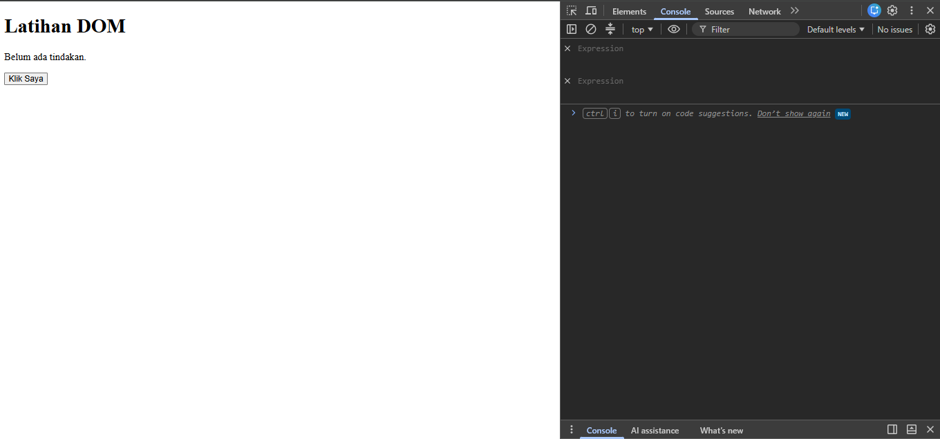

---

# Langkah-Langkah Praktikum

### Mengubah teks dengan DOM di script.js

**script.js**

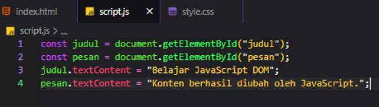

**Hasil di browser**  

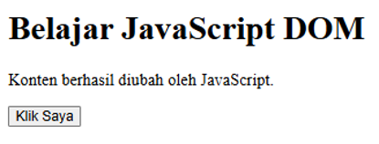
---

### Membuat event click di script.js
Disini const pesan sudah di deklarasikan sebelumnya jadi di hapus saja karena akan mengakibatkan error

**script.js**

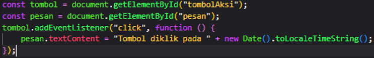

**Hasil di browser**  

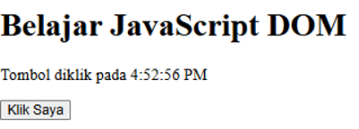

**jika di klik lagi waktubya akan di perbarui sesuai jam saat mengklik**

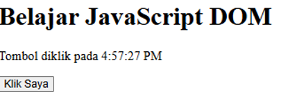

---

### Lanjut dengan mengubah kelas dan gaya CSS

**style.css**

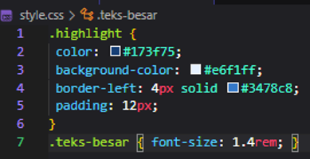

**script.js**

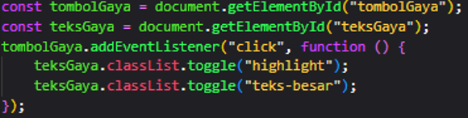

Buat juga paragraph teksGaya dan button tombolGaya di `index.html`

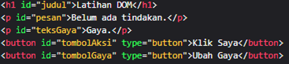

**Hasil di browser**  

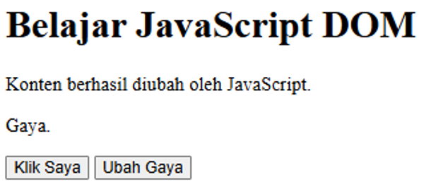

**ketika di klik**

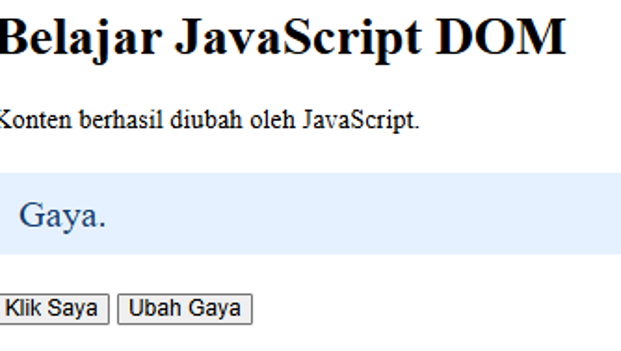

Disini Ketika menggunakan `classList.toggle()` saat di klik akan berubah seperti di screenschoot ke dua dan saat di klik lagi akan Kembali ke sebelumnya, lalu saat menggunakan `classList.add()` saat di klik akan berubah seperti saat menggunakan toggle tapi saat di klik Kembali tidak bisa Kembali ke sebelumnya, sedangkan saat menggunakkan `classList.remove()` Ketika di klik tidak terjadi apapun.

---

### Buat input teks dan indikator jumlah karakter yang diperbarui saat pengguna mengetik

**index.html**

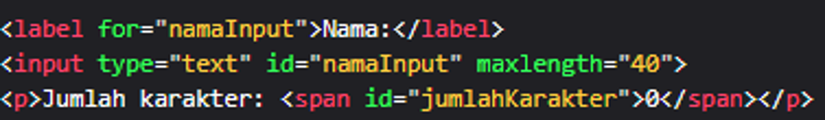

**script.js**

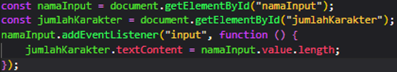

**Hasil di browser**  

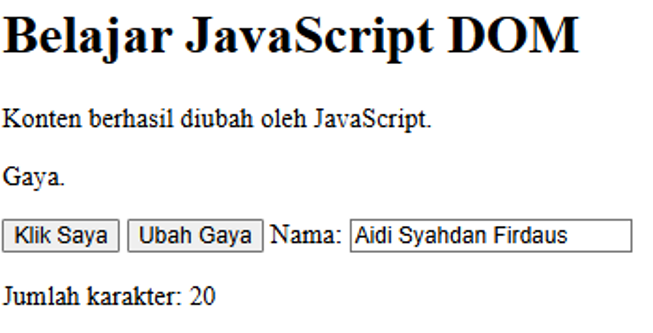

---

### Buat form nama, email, dan usia. Program menampilkan pesan jika input tidak sesuai.

**index.html**

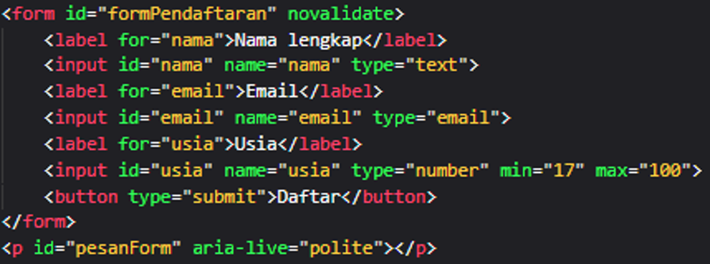

**script.js**

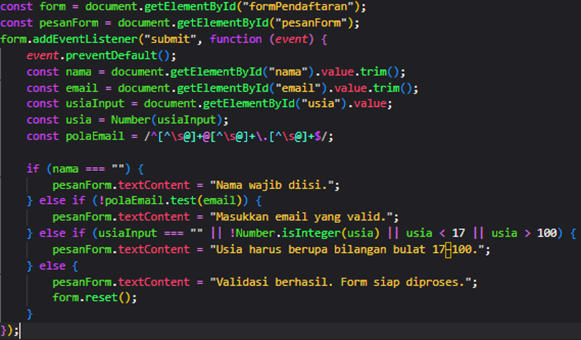

**Hasil di browser jika nama kosong**  

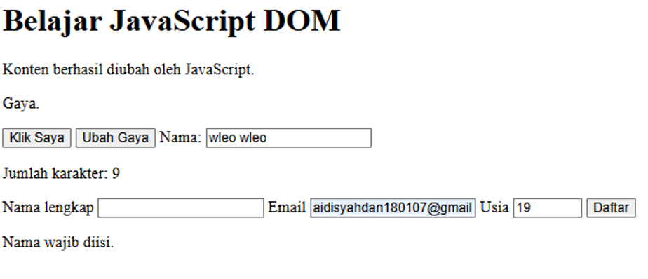

**Hasil di browser jika email tidak sesuai**  

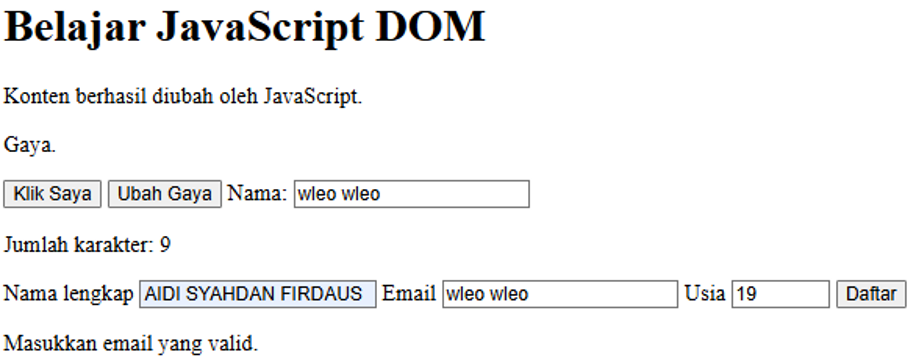

**Hasil di browser jika usia bukan tipe data integer(bilangan bulat)**  

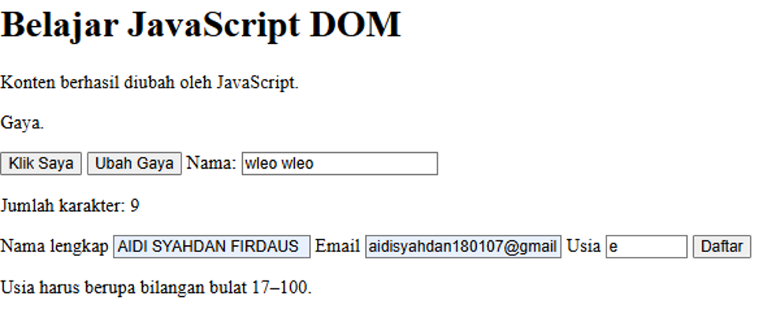

**Hasil di browser jika form yang diisi valid**  

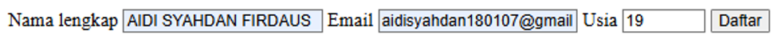

**form akan otomatis kosong kembali jika tombol daftar di klik**

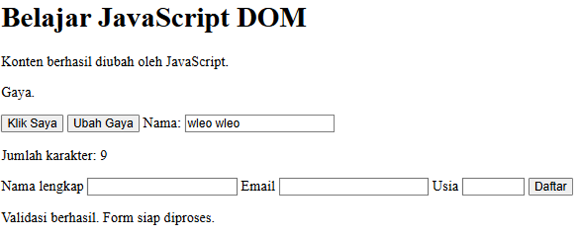

---

### Buat aplikasi kecil untuk menambahkan tugas dan menandai tugas selesai.

**index.html**

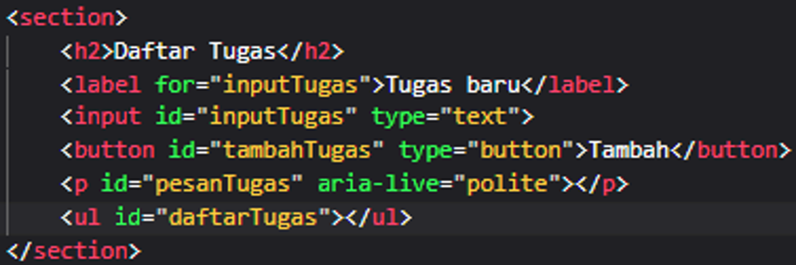

**script.js**

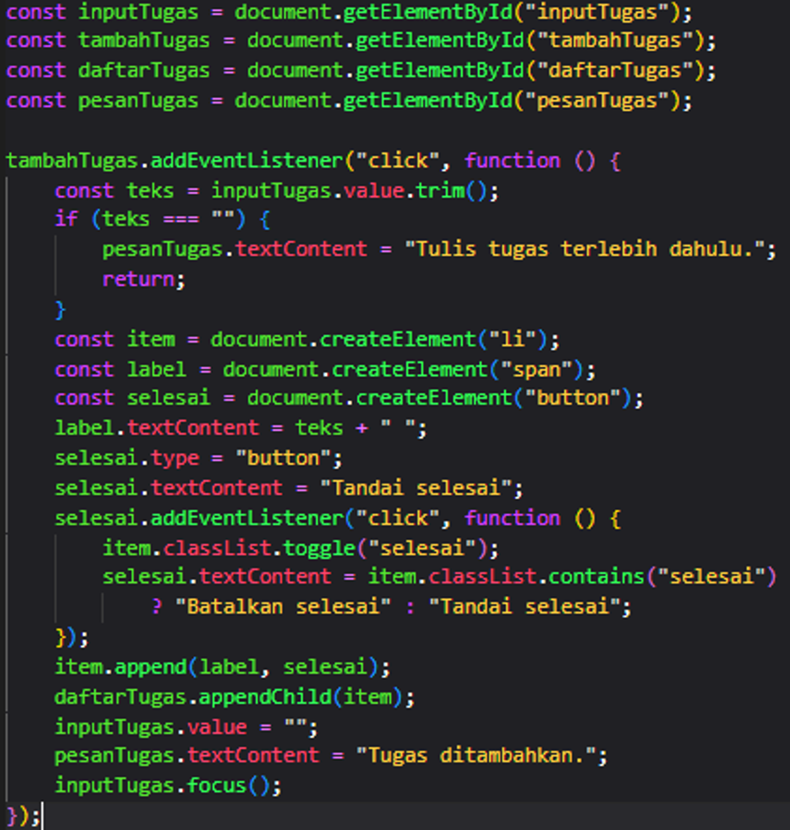

**style.css**

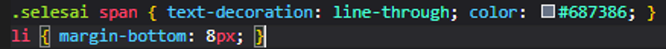

**Hasil di browser Ketika memasukkan input di form Tugas Baru**  

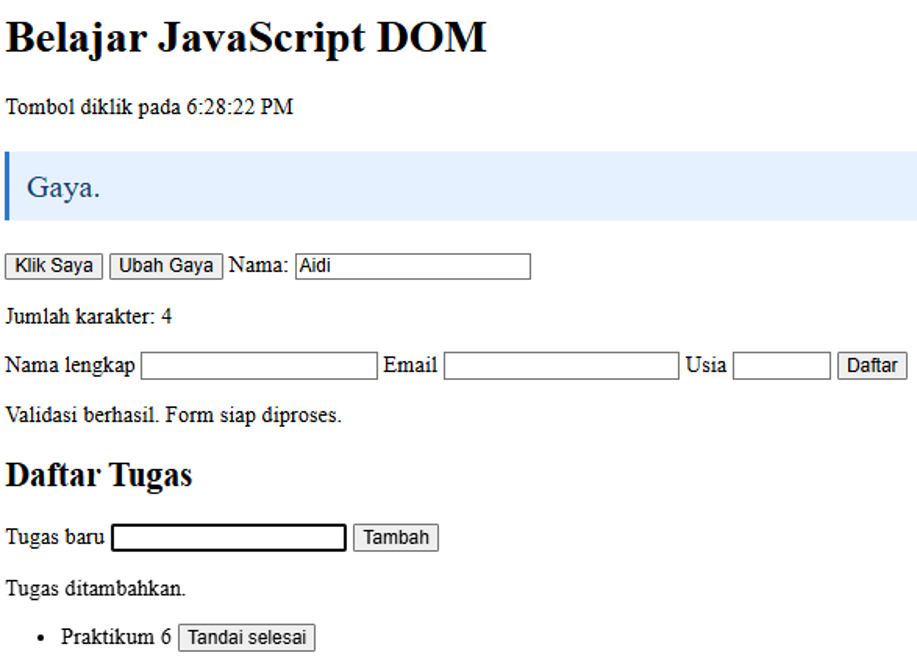

**Ketika button Tombol selesai di klik**  

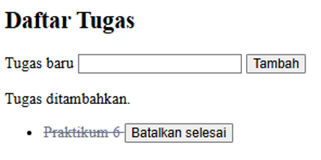

**Ketika di batalkan(kembali ke sebelumnya)**  

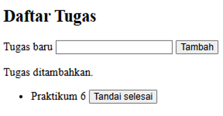

---

# EKSPERIMEN MANDIRI

### 1. Tambahkan tombol untuk menghapus satu item dari To-do List.

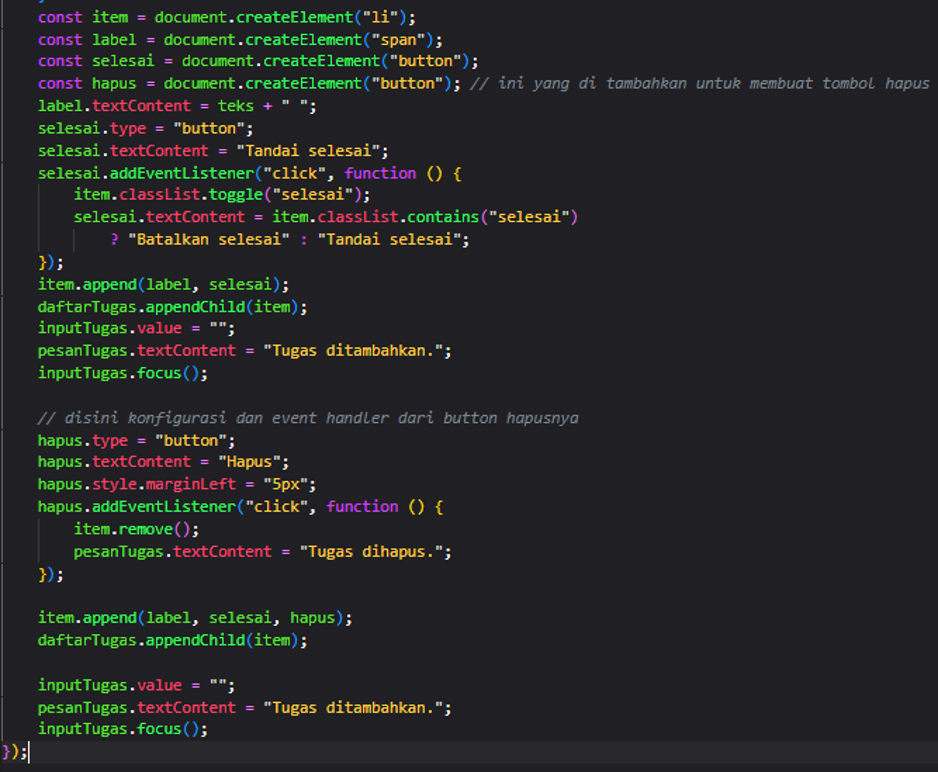

**Hasilnya**  

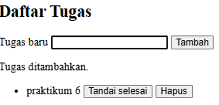

**Ketika di hapus**  

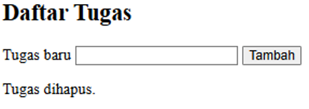

---

### 2. Ubah validasi agar nama minimal terdiri dari tiga karakter.

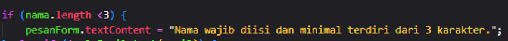

**Hasilnya**  

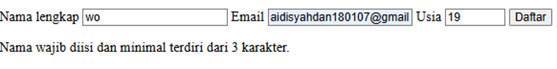

---

### 3. Tambahkan event change pada dropdown sesi workshop dan tampilkan sesi yang dipilih.

**index.html**

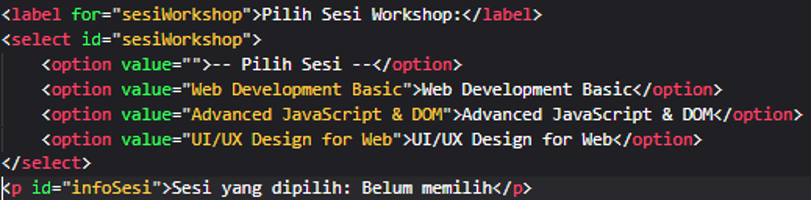

**script.js**

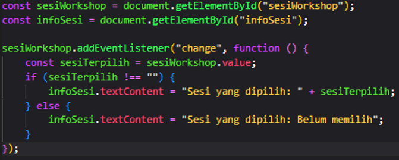

**Hasilnya**  

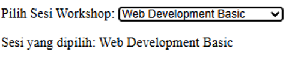

---

### 4. Buat tombol untuk menyembunyikan dan menampilkan paragraf menggunakan class CSS.

**index.html**

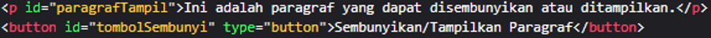

**style.css**

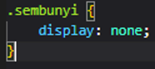

**script.js**

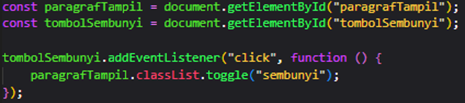

**Hasilnya**  

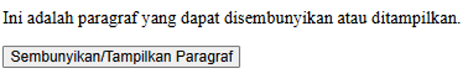

**Jika di sembunyikan**  

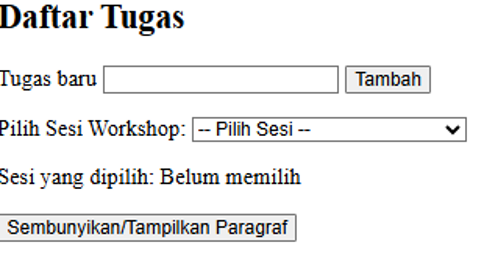

---

### 5. Coba pindahkan script tanpa defer ke bagian head. Amati kemungkinan masalah dan jelaskan penyebabnya.

**Tanpa defer**

**yang terjadi**

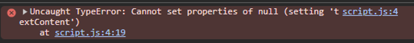

**Penjelasannya:**  
Pas tag skrip dipindahin ke bagian head tanpa pake atribut defer, browser bakal langsung ngunduh sama ngejalanin file script.js saat itu juga sebelum selesai membaca elemen HTML di bagian body. Kondisi ini bikin kode JavaScript udah keburu jalan padahal struktur DOM belum selesai dibuat. Akibatnya, fungsi pencarian elemen kayak document.getElementById() nggak bisa nemuin elemen yang dicari dan malah ngasilin nilai null. Nah, pas kodenya mencoba nambahin event listener atau ngubah teks dari nilai null tersebut, browser langsung ngelempar error TypeError yang bikin fungsi interaktifnya ga bisa jalan sama sekali.

---

# PERTANYAAN EVALUASI

1. **Apa yang dimaksud dengan DOM dan apa manfaatnya?**  
   DOM (Document Object Model) adalah representasi struktur dokumen HTML dalam bentuk objek yang dapat diakses dan dimanipulasi oleh JavaScript. Manfaatnya yaitu membuat program dapat memilih elemen, mengubah konten, menambah atau menghapus kelas CSS, serta merespons berbagai tindakan pengguna pada halaman web.

2. **Apa perbedaan getElementById(), querySelector(), dan querySelectorAll()?**  
   - `getElementById()` digunakan untuk memilih elemen HTML secara spesifik berdasarkan nilai id-nya.  
   - `querySelector()` memilih elemen pertama yang cocok dengan selector CSS yang ditentukan.  
   - `querySelectorAll()` memilih semua elemen yang cocok dengan selector CSS tersebut.

3. **Apa fungsi addEventListener() dan sebutkan tiga contoh event?**  
   Fungsi `addEventListener()` adalah untuk menghubungkan suatu event dengan fungsi yang akan dijalankan saat event tersebut terjadi. Contoh event yang disebutkan dalam modul antara lain click, input, change, submit, keydown, dan mouseover.

4. **Mengapa event.preventDefault() digunakan pada event submit form?**  
   `event.preventDefault()` digunakan pada event submit untuk mencegah halaman web memuat ulang (refresh) secara otomatis sebelum pemeriksaan data atau proses validasi form selesai dilakukan.

5. **Apa perbedaan textContent dan innerHTML dari sisi penggunaan dan keamanan?**  
   - **Penggunaan:** `textContent` digunakan untuk mengubah atau menampilkan konten berupa teks biasa, sedangkan `innerHTML` dapat mengubah dan memasukkan struktur markup HTML.  
   - **Keamanan:** Memasukkan teks dari pengguna yang tidak dipercaya menggunakan `innerHTML` harus dihindari karena dapat menimbulkan risiko keamanan (seperti ancaman XSS), sedangkan `textContent` lebih aman karena menampilkan data pengguna murni sebagai teks biasa tanpa mengeksekusi markup HTML.

6. **Bagaimana classList.toggle() membantu mengubah tampilan elemen?**  
   `classList.toggle()` membantu mengubah tampilan elemen secara dinamis dengan cara menambah atau menghapus kelas CSS secara bergantian ($on/off$) setiap kali fungsi dipanggil, tergantung apakah kelas tersebut sudah ada pada elemen atau belum.

7. **Sebutkan minimal tiga skenario pengujian validasi form.**  
   Tiga contoh skenario pengujian validasi form berdasarkan modul yaitu:  
   1. Pengujian saat semua kolom input dibiarkan kosong.  
   2. Pengujian saat format email tidak valid (misal: tidak sesuai pola @ dan domain).  
   3. Pengujian saat nilai usia di luar ketentuan (misal: di bawah 17 tahun atau bukan bilangan bulat).